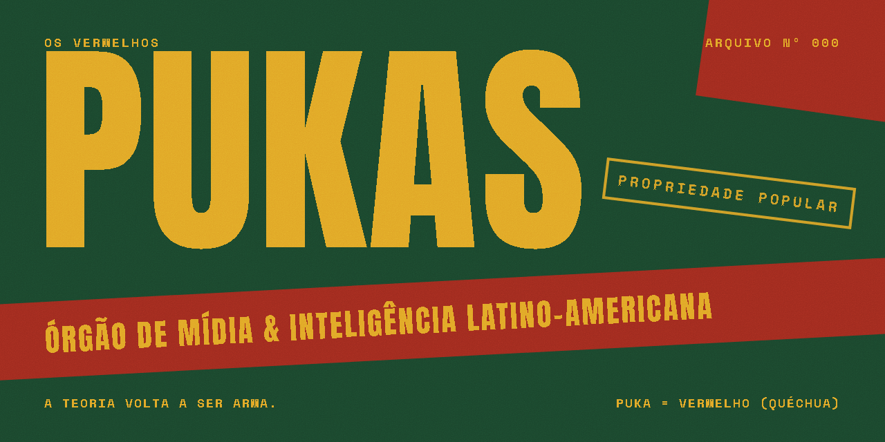

<p align="center">
  
</p>

# PUKAS — Os Vermelhos

*Puka* é "vermelho" em quéchua. O PUKAS é um órgão de mídia latino-americano que fala como conversa de bar: simples, denso e sempre com a fonte à vista.

> **O fato ganha da tese.** Toda informação tem fonte. Se a gente errar, corrige em público.

---

## Status

🟢 **No ar em [pukas.vercel.app](https://pukas.vercel.app).** Falta a primeira edição real e o domínio `pukas.lat`.

| Seção | Status |
|---|---|
| Newsletter **Memória Operária** (`/newsletter/memoria-operaria/001`) + endereço curto `/001` | ✅ código · ⏳ primeira edição |
| Página da bio (`/links`) | ✅ |
| Manifesto público (`/manifesto`) | ✅ |
| **Cultura** (`/cultura`): contos, cenas, poemas e ensaios | ✅ código · ⏳ primeira obra |
| Menu lateral (computador) e MENU em tela cheia (celular) | ✅ |
| Capa e RSS | ✅ |
| Deploy | ✅ `pukas.vercel.app` · ⏳ domínio `pukas.lat` |
| **Notícias** (`/noticias`) | ✅ código · ⏳ primeira notícia |
| Painel `/painel` (Supabase, senha + 2FA): Estúdio, Agenda e Equipe | ✅ código · ⏳ no ar |
| Robô de notícias, gerador do carrossel, Raio-X, dossiês, documentários, loja | ⚪ ver o [roadmap](docs/roadmap.md) |

## Como uma peça vai ao ar

Todo o conteúdo mora no **Supabase**. Edição, obra de Cultura, notícia e manifesto são publicados pelo painel em **`/painel`**, que pede senha e 2FA.

1. Em `/painel`, crie a peça e preencha: frase, texto, foto (com crédito e licença), fontes e checagem. Siga o [guia de checagem](docs/editorial/checagem.md).
2. **O banco recusa a publicação** quando falta fonte primária, falta licença ou crédito da foto, falta checagem ou a manchete passa de 8 palavras. O painel mostra o motivo.
3. Ao publicar, a peça aparece na hora no endereço dela, na capa, em `/links` e no RSS: o cache da borda é renovado pelas etiquetas.
4. Para corrigir uma peça já publicada, use "corrigir" no painel. A correção aparece em público na peça, e o histórico guarda a versão anterior.

Ficção (Cultura) não precisa de fonte. No poema, as quebras de linha ficam como você escreveu.

## Agenda editorial

Em `/painel/agenda`, a equipe anota o que sai em cada dia: tipo (e série), título provisório, nota, responsável e situação. No celular aparece só a semana; no computador, semana e mês. Um item pode ser ligado a uma peça do Estúdio, e aí a situação acompanha a peça (escrevendo, em revisão, publicada). "Começar a escrever" abre o editor já ligado ao item.

O **ritmo da casa** (`/painel/agenda/ritmo`) são os compromissos fixos, como "Newsletter · Memória Operária, toda segunda". Na agenda, cada um aparece como um espaço tracejado no dia dele, até um item ocupar o lugar. Só o editor muda o ritmo. Nada na agenda é automático além de acompanhar o estado da peça: ela organiza, não publica.

## Busca (robô de notícias com curadoria)

Em `/painel/busca`, o robô entrega uma **pauta** de até 10 candidatas na segunda, na quarta e na sexta às 7h, ou quando o editor aperta "Rodar agora". Cada candidata traz por que importa para quem trabalha, as fontes lidas (marcadas "livre" quando vêm de fora das fontes fixas) e o que falta confirmar. Editor e revisor escolhem "Virar rascunho" (o robô escreve a notícia, que entra no Estúdio como **Notícia em revisão**, com a checagem em branco) ou "Descartar" com o motivo, que o robô usa na rodada seguinte. **O robô nunca publica.**

- **Onde roda:** o workflow `busca.yml` (GitHub Actions, a cada 15 min) com `scripts/busca.ts`. Ele usa o Claude Sonnet 5.5 com busca e leitura na web.
- **Teto:** o gasto do mês aparece em reais no painel. Antes de cada rodada o robô confere se ainda cabe uma; se não couber, registra "teto atingido". O teto, o câmbio, os dias, a hora, os temas, as fontes fixas e a busca livre ficam em `/painel/busca/config`, só para o editor.
- **Linha editorial do robô:** `src/lib/busca/instrucoes.ts`.

## Votações

Em `/votacoes`, a base diz se é a favor, contra ou não sabe de um PL, PLP ou PEC da Câmara ou do Senado ([spec](docs/specs/2026-11-08-consultas-design.md)). A redação cria a votação no Estúdio (tipo **Votação**): escolhe a casa, o tipo, o número e o ano, e o "Buscar" traz a ementa e o link oficiais. Ela passa pela mesma revisão de qualquer peça e fecha na primeira votação nominal do plenário ou 30 dias depois de publicada.

- **Voto:** só entra por `POST /api/votar`, com a chave de serviço (nenhuma política do banco deixa o público ler ou gravar voto). Anti-robô Cloudflare Turnstile, um voto por aparelho (cookie aleatório, guardado só como HMAC), campo escondido que descarta robô em silêncio e, a partir do 31º voto da mesma rede na mesma hora, descarte marcado. Nada é apagado: os descartes aparecem na metodologia.
- **Comprovante:** `#PK-XXXXXX`, conferível na lista pública da votação.
- **Alto impacto:** a votação pede login com Google. O banco guarda só o HMAC do id do Google, e a conta temporária é apagada do Supabase depois do voto.
- **Plenário:** o workflow `plenario.yml` (todo dia, 7h40) com `scripts/plenario.ts` lê as votações nominais nas APIs abertas da Câmara e do Senado, grava o placar e fecha a votação.
- **Na redação:** a votação publicada mostra no painel os votos, os relatos agrupados por opção (só editor e revisor) e o botão "Virar rascunho de notícia". O texto sempre diz "de quem votou no PUKAS".

## Português e espanhol

O site inteiro existe em `/es/...`, em espanhol neutro latino-americano. O idioma é escolhido no servidor, nesta ordem: a escolha da pessoa no seletor PT | ES, o idioma do aparelho e o país.

Ao publicar, a peça vai para a tradução automática pela API de lotes do Claude (`claude-sonnet-5-5`, metade do preço). O workflow `recolher-traducoes.yml` busca o resultado a cada 15 minutos. Até lá, `/es` mostra o original com o aviso TRADUCCIÓN EN CAMINO. A tradução sai com o selo TRADUCCIÓN AUTOMÁTICA até alguém revisar na aba Espanhol do painel. Se ela mudar algum número do original, é recusada e fica marcada como erro no painel, com o botão "tentar de novo".

## Operação

| Segredo | Onde | Para quê |
|---|---|---|
| `SUPABASE_URL`, `SUPABASE_ANON_KEY` | Vercel e GitHub | ler o banco (a chave anon é pública por natureza) |
| `ANTHROPIC_API_KEY` | Vercel e GitHub | enviar e recolher as traduções |
| `RENOVAR_SEGREDO` | Vercel e GitHub | autorizar o `POST /api/renovar` do recolhimento |
| `SUPABASE_SERVICE_ROLE_KEY`, `SITE_URL` | só GitHub | gravar as traduções recolhidas e o placar do plenário |
| `SUPABASE_SERVICE_ROLE_KEY` | Vercel | convites da equipe e gravar votos |
| `PUBLIC_TURNSTILE_SITE_KEY`, `TURNSTILE_SECRET` | Vercel | anti-robô das votações (Cloudflare Turnstile) |
| `VOTO_SEGREDO` | Vercel | HMAC do aparelho, da rede e da conta nas votações |

O `VOTO_SEGREDO` é gerado no próprio computador e colado na Vercel. Trocar esse segredo faz todo aparelho poder votar de novo nas votações abertas:

```
node -e "console.log(require('crypto').randomBytes(32).toString('hex'))"
```

Cada segredo é colado direto no painel de cada serviço. Nunca vai para o repositório nem para o chat.

- **`arquivo-diario.yml`** (todo dia): exporta tudo o que está publicado para [`arquivo/publicado.json`](arquivo/publicado.json), com commit só quando muda. É o backup público, e a consulta diária impede o plano grátis do Supabase de pausar o projeto.
- **`recolher-traducoes.yml`** (a cada 15 min): grava as traduções prontas.
- Sem os segredos, os dois workflows não fazem nada.
- A equipe entra por convite (`/painel/equipe`) e recebe um papel (`editor`, `revisor` ou `redator`) na tabela `perfis`. O único cadastro aberto é o login Google das votações de alto impacto: essa conta não tem papel, não abre o painel e é apagada depois do voto.

## Rodando localmente

Requisito: Node 24.

```bash
npm install
npm run dev      # http://localhost:4321
npm test         # regras editoriais, formatação, contraste da paleta
npm run check    # tipos
```

O `npm run dev` precisa de `SUPABASE_URL` e `SUPABASE_ANON_KEY` no ambiente. Os testes do banco (`npm run test:banco`) e o build do adaptador Vercel rodam no CI, porque precisam de Docker e de Linux.

## Stack

TypeScript (`strict`) · **Astro** renderizado no servidor do Vercel, com cache na borda e quase nenhum JavaScript no cliente · conteúdo no **Supabase** (Postgres com RLS, Auth com 2FA e Storage) · CSS com tokens · Vitest · GitHub Actions. O porquê está no [ADR-0001](docs/decisoes/ADR-0001-linguagem-e-stack.md), no [ADR-0002](docs/decisoes/ADR-0002-supabase-backend.md) e na [spec do painel](docs/specs/2026-11-06-painel-design.md).

## Identidade (v2.0)

| Pau-Brasil | Tinta | Cal | Ipê | Verde-Mata |
|:-:|:-:|:-:|:-:|:-:|
| `#9E2A1E` | `#1C1A17` | `#F1EDE4` | `#E0A526` | `#1A452C` |
| marca | texto | papel | destaque | técnico |

A marca é a **Tarja**. A tipografia usa **Archivo** (manchete comprimida), **Space Mono** e **Anton** (só no carimbo). O manual está em [`docs/design/identidade-visual.md`](docs/design/identidade-visual.md).

## Estrutura

```
src/
├─ pages/painel/                            painel (estúdio, agenda, equipe, edição, espanhol, login com 2FA)
├─ lib/                                    regras puras + testes (edicoes, formato, banco, painel, traducao, cache)
├─ components/identidade/                  Tarja, Carimbo, Selo, Grão
├─ layouts/ · pages/ · styles/ · data/ (links.ts, navegacao.ts)
supabase/migrations/                       tabelas, travas editoriais, RLS
scripts/                                   migração inicial, recolher traduções, backup
arquivo/publicado.json                     backup diário do publicado
docs/
├─ specs/ · planos/ · decisoes/           spec → plano → código
├─ design/                                 identidade v2.0 + originais
├─ editorial/checagem.md                   compromisso com a verdade
└─ produto/fundamentos-interno.md         texto teórico de origem (não publicar)
```

## Licença

- **Código:** [AGPL-3.0](LICENSE).
- **Textos e conteúdo editorial:** [CC BY-SA 4.0](LICENSE-CONTEUDO.md).

## Como trabalhamos

Spec → plano → implementação, uma seção por vez, e toda mudança entra por PR. Veja o [`CONTRIBUTING.md`](CONTRIBUTING.md).
